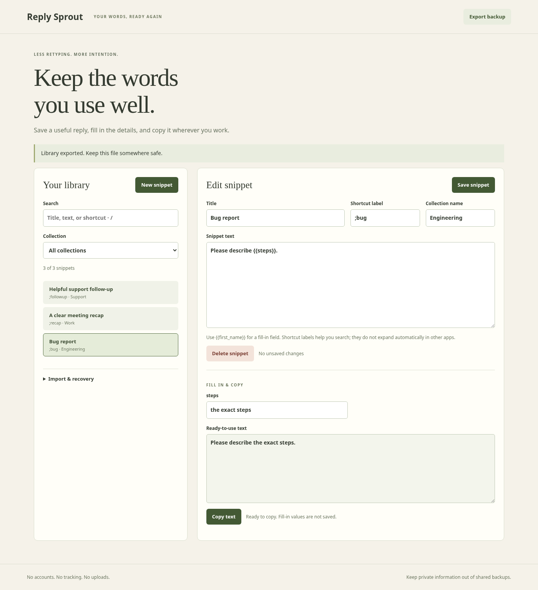

<div align="center">


### Open-source alternative to TextExpander for reusable text snippets and templates

Fill the details. Copy. Get on with your day.

**MIT licensed** · **Own your data** · **No AI service required**

[**Start →**](#start) · [Workflow](#the-workflow) · [MIT license](LICENSE)

</div>

> Public source preview. No system-wide automatic text expansion; hosted HTTPS acceptance remains pending.



*Actual application screenshot showing a saved template, fill-in field and copy workflow.*

## The workflow

**Save a useful reply → fill variables → copy the result → back up your library.**

A local-first library for the replies and templates you reuse. Search your snippets, fill in variables, copy the result and export your library as JSON. MIT licensed. No account, backend, AI service or analytics. Independent product repository; source is published, while hosted HTTPS acceptance remains pending.

## Start

Requires Python 3 only to serve the static files locally:

```sh
python3 -m http.server 5130 --bind 127.0.0.1
```

Open http://127.0.0.1:5130 in a current Chromium browser. Node is not required to use the app. Keep the same browser profile and origin (scheme, hostname and port) to access the same library. Do not open index.html through file://: browser modules and safe storage locks need localhost or HTTPS.

1. Choose **New snippet**, or start with the two editable examples.
2. Write a title, optional shortcut label and collection, then your text. Use `{{first_name}}` for a fill-in field. Variable names start with a letter and contain up to 40 letters, numbers or underscores.
3. Save. Fill in the fields under the editor and choose **Copy text**. Paste into your destination app.
4. Search by title, body, shortcut or collection; filter by collection. `/` focuses search outside a text field; Ctrl/Cmd+Enter saves.
5. Export a JSON backup regularly. Import can merge identical records or replace the whole library after confirmation. Different versions of the same snippet ID are rejected in merge mode to prevent silent loss.

Shortcut labels are searchable labels, **not system-wide automatic text expansion**. Snippets are plain text; no code or HTML is executed. Fill-in values stay in memory and are excluded from saved snippets and exports. Clipboard denial selects the output so you can copy manually.

## Storage and recovery

The library stays in localStorage under your browser profile and origin. It is not encrypted and does not sync. Clearing site data, private browsing, profile loss or moving to a different origin can lose access. Do not treat this as a password manager. Backups contain your snippet text; review them before sharing.

Limits: 500 snippets, 20,000 characters per template, 2 MB total saved library/import. Save failures retain the draft. Browser storage locks serialize writes; revision checks reject stale-tab overwrites. If another tab changes the library while you edit, copy your draft before reloading. A readable but old backup can intentionally replace newer content only in replace mode after confirmation.

Corrupted saved data is not silently reset. Open Import & recovery, export raw recovery data, then import a known-good JSON backup using Replace whole library. Raw recovery export preserves the original bytes for inspection, even if they are invalid JSON.

## Self-host

Serve the directory with a static HTTPS host at a stable URL. No API endpoints, server database or secrets are needed. All snippet data remains in each visitor's browser; hosting this directory does not publish anyone's saved library. The app's CSP blocks network connections from its code and allows only same-origin scripts/styles. HTTPS or localhost is required for clipboard and Web Locks. Chromium is tested; Safari, Firefox and physical mobile input remain unverified.

## Tests

```sh
npm ci
npm test
npx playwright install chromium
# Keep the local server above running, then:
npm run test:browser
```

`TEST_URL` overrides localhost and `CHROMIUM_PATH` selects an installed Chromium binary. Browser tests use an isolated browser context and synthetic example text, including clipboard, reload persistence, import/export, conflicting cross-tab saves and corrupt-data recovery. Screenshots go to artifacts/. All dependencies are development-only.

## Compared with TextExpander

This addresses reusable plain-text templates and fill-in variables. It provides browser-local collections, search, clipboard copy and portable JSON backups. It does not provide native text expansion, automatic insertion into other apps, team sharing or cloud sync. No feature-parity, pricing or performance claim is made. Verified vendor reference (November 14, 2026): https://textexpander.com/learn/using/snippets/snippet-fill-ins documents fill-in fields, including repeated values with the same field name. Reply Sprout supports basic text fields only; the vendor also documents richer field types. Pricing and the full vendor feature inventory have not been audited.

## Distribution path

Publish this independent repository and a static demo first. Include a short, concrete support-reply walkthrough showing creation, filled variables and a portable backup. Supply a small, reviewed support-template JSON pack that can be imported into the demo. A useful tutorial in an owned project's contributor/support docs is the first distribution opportunity; external listings require a working public URL and a current contribution-policy review. No listings, external PRs or promotional posts have been submitted.

## Release status

Local candidate; see artifacts/validation.json for actual checks and pending gates. Public repo, static deployment and broader name review are pending. GitHub's quoted snippet-cabinet repository search returned no results on November 14, 2026; that is not comprehensive name clearance.

## Interface languages

English · Deutsch · Español · 日本語 · 简体中文 · 繁體中文

The interface follows your browser preferences until you choose a language. Switching keeps your draft and saves your choice locally. Translations are bundled; no translation service or telemetry is used. Your content is never translated. Unknown technical diagnostics fall back to English. See [localization notes](I18N.md) for scope and testing.

## Current verification

See the [26 November audit checkpoint](docs/AUDIT.md) for the verified repository, release links, fresh core test result and remaining deployment/browser gates. Earlier validation records remain dated evidence.

## GitHub Pages deployment

An administrator must first choose **GitHub Actions** under Settings → Pages. Then run **Publish static app** from Actions on `main`. The workflow runs core, translation and browser checks against the exact static package before deploying. It preserves GitHub environment protections; approval requirements still apply. This setup is prepared, but no hosted URL has been verified yet.

To build the same package yourself, run `python3 scripts/package-site.py site` with a new output directory. Only the app's required HTML, CSS, JavaScript and license are included; source history, tests, screenshots and development dependencies are excluded. Serve `site` from an HTTPS static host. User libraries are stored in browsers and are never part of this package. The script refuses to overwrite an existing output directory.

Moving from localhost or another hostname changes the browser storage origin. Export your JSON backup before moving, then import it at the new URL. Keep the original backup until the imported library and copy workflow are verified.
